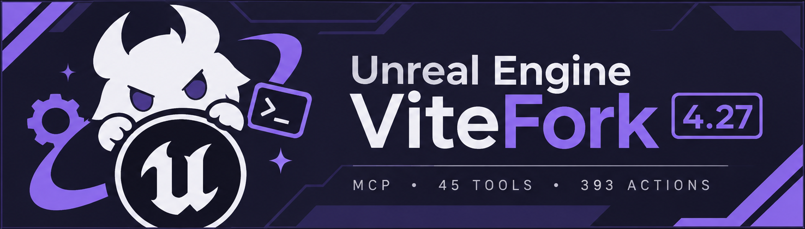
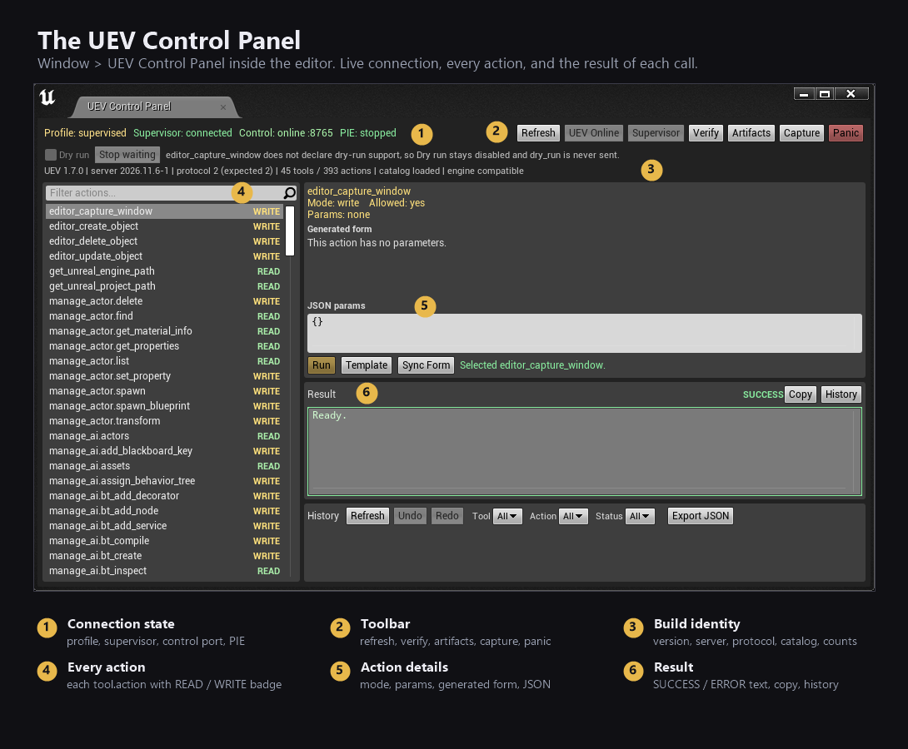
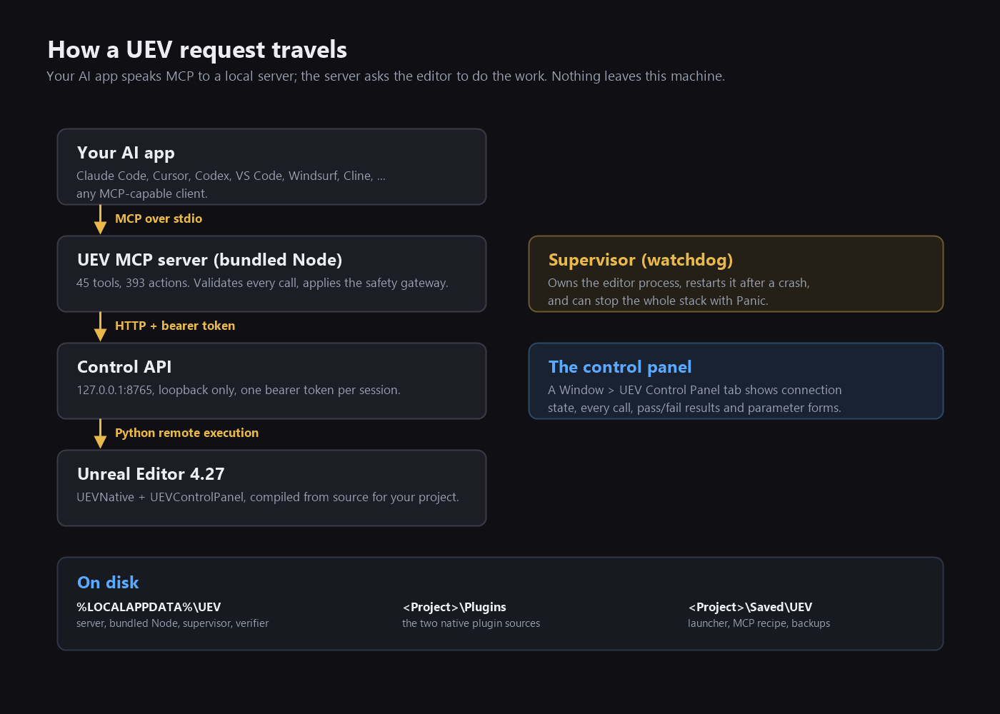

<p align="center">
  
</p>

# UEV: give your AI assistant hands inside Unreal Editor 4.27

<p align="center">
  <a href="https://github.com/santera-pixel/uev/releases/latest"></a>
  
  
  
</p>

UEV connects an AI assistant to your **Unreal Engine 4.27** editor. Claude Code, Cursor, Codex, VS Code,
Windsurf, Cline, or any other MCP client: they all speak the same protocol, and this is the other end of
it.

You stop clicking through the same menus for the tenth time and describe what you want instead. The
assistant looks around your project, makes the change, and you watch it land in the viewport. It can
place actors, build Blueprints and widgets, author materials and animation graphs, run Python, take
screenshots, start PIE, and read the log when something breaks. All of it is a tool call.

Nothing here is a black box. Every call passes through a native panel you can watch, writes go through
a safety gateway, and any config file that gets touched is backed up first.

> Package 1.7.0, server 2026.11.6-1, protocol 2. The installable zip is on the
> [releases page](https://github.com/santera-pixel/uev/releases/latest). This branch, `main`, is the
> front door: docs and screenshots. The code lives on
> [`dev`](https://github.com/santera-pixel/uev/tree/dev).



## What you need

| You need | Why |
| --- | --- |
| Windows 10 or newer | The package, the installer and the native capture path are Windows only |
| **Unreal Engine 4.27.x** | The server refuses other versions, and graph authoring targets the 4.27.2 [Vite fork](https://vitestudio-tech.github.io/UnrealEngineVite-Docs/default-topic.html) |
| A **C++ project** (`Source/<Project>.Target.cs` and `.Build.cs`) | Both editor plugins compile from source against your engine |
| Visual Studio and UnrealBuildTool | The build has to happen on your machine |
| `PythonScriptPlugin` (ships with Unreal) | Tool calls reach the editor through Python remote execution |
| `EditorScriptingUtilities` | Asset and editor scripting helpers |
| Editor closed while installing or updating | The plugins are compiled and copied into the project |

You don't need Node.js, the .NET runtime, administrator rights, a Windows service, a firewall rule, or
an internet connection while installing. Node, the supervisor and the server are inside the package.

## Install (five minutes, plus the first plugin build)

1. **Download** `uev-1.7.0.zip` from [releases](https://github.com/santera-pixel/uev/releases/latest)
   and unzip it somewhere, `D:\UEV` will do.
2. **Close Unreal Editor.** The installer compiles plugins into your project, and a running editor holds
   those files open.
3. **Double-click `install.bat`.** It finds your project and engine, shows a component menu with
   sensible defaults, builds the two native plugins, and writes the launcher.
4. **Pick your AI app** when the installer asks, so it can write (or print) the right MCP config.
   Accepting the defaults is fine, you can register later.
5. **Start the stack** with `Launch UEV.bat` from the package folder, or open the editor and press
   **Start MCP** in the panel.
6. **Check it.** Open **Window > UEV Control Panel** (console: `UEV.ControlPanel`) and click
   **Verify**. The header should show your version, `protocol 2`, `45 tools / 393 actions` and
   `catalog loaded`.

The installer is idempotent and non-destructive. It copies files, backs up anything it edits, and
`uninstall.bat` removes what it added. Nothing is installed as a service or a startup entry.

Command line equivalent, if you prefer:

```powershell
.\install.ps1 -Project "C:\Projects\MyGame\MyGame.uproject" -Profile supervised -Yes
```

Full flag list and component names: [docs/install.md](docs/install.md).

## Connect your AI app

Registration happens once. The installer writes a ready-to-copy recipe to
`<Project>\Saved\UEV\mcp-client.json`:

```json
{
  "mcpServers": {
    "uev": {
      "transport": "stdio",
      "command": "C:\\Users\\<you>\\AppData\\Local\\UEV\\node\\node.exe",
      "args": ["C:\\Users\\<you>\\AppData\\Local\\UEV\\app\\dist\\bin.js"],
      "env": {
        "UEV_PROFILE": "supervised",
        "UEV_BIND_ADDRESS": "127.0.0.1",
        "UEV_COMMAND_ADDRESS": "127.0.0.1",
        "UEV_MULTICAST_TTL": "0"
      }
    }
  }
}
```

The installer knows where 20 harnesses keep their MCP list and can write the entry for you:

```powershell
.\install.ps1 -ListClients
.\install.ps1 -Project "C:\Projects\MyGame\MyGame.uproject" -Client claude-code -Update -Yes
```

Writable JSON configs, other servers preserved and the old file backed up: Claude Code, Claude Desktop,
Cursor, VS Code, Windsurf, Roo Code, Gemini CLI, Zed, Kiro, Pi and Google Antigravity. Clients whose
config is TOML, YAML or managed inside the app print the exact snippet instead: Codex CLI, Continue,
goose, opencode, Cline, JetBrains, GitHub Copilot CLI and DeepSeek Harness. Anything else can use
`-ClientConfig <path>` or the recipe above.

The recipe is not registration. The AI app has to load that entry itself, and no installer can reach
into another app's settings for you. After registering, restart the client (or reconnect its MCP
servers) and the tools show up as `mcp__uev__manage_actor`, `mcp__uev__manage_blueprint`, and so on.

## What you can ask it to do

45 tools, 38 namespaces, 393 actions. These are the namespaces worth knowing:

| Tool | What it is for | Actions |
| --- | --- | ---: |
| `manage_actor` | Find, spawn, transform, delete and inspect level actors | 9 |
| `manage_blueprint` | Blueprints: components, event/function/Construction graphs, variables | 38 |
| `manage_widget` | UMG widget Blueprints: tree edits, slots, anchors, styling, spawning | 38 |
| `manage_animation` | AnimGraphs, state machines, sequence notifies/curves, montage sections | 43 |
| `manage_ai` | AI controllers, behavior trees and blackboards, navmesh, perception | 27 |
| `manage_material` | Material and MaterialFunction graphs, instances, parameters | 22 |
| `manage_editor` | Run Python, console, PIE lifecycle, viewport, camera, input | 25 |
| `manage_asset` | List, search, inspect, move, duplicate, delete and save assets | 15 |
| `manage_sequence` | Level sequences: bindings, tracks, sections, keys, camera cuts | 14 |
| `manage_geometry` | Thirteen preset builders: wall, maze, pyramid, bridge, house, castle | 13 |
| `manage_vite` | Vite renderer cvars, render state, presets, allowlisted console commands | 13 |
| `manage_debug` | Health, plugins, supervisor status, log tails, panic/reset | 12 |
| `manage_source_control` | Provider inspection, checkout/add/delete/revert | 12 |
| `manage_object` | Any UObject: schema, property paths, function calls, spawn by class | 10 |
| `manage_physics` | Physics Blueprints, collision profiles, forces and impulses in PIE | 9 |
| `manage_code` | C++ and Live Coding status, source reads and writes with backups, build logs | 8 |
| `manage_history` | Native undo/redo with semantic metadata | 6 |

The other twenty-one namespaces cover lighting, volumes, levels, navigation, splines, audio, textures,
skeletons, data assets, effects, profiling, project audits, GAS, DDGI volumes, build planning, editor
utility widgets and polling helpers. A few single actions (`editor_capture_window`, the `editor_*`
object actions, `get_unreal_engine_path`, `get_unreal_project_path`, `manage_batch`) are direct tools
rather than namespaces.

Every namespace tool takes the same shape:

```json
{ "action": "find", "params": { "pattern": "Light" } }
```

Some things people actually ask for:

- "Find every point light within 500 units of PlayerStart and drop their intensity by 30%."
- "Make a material instance of `M_Rock` called `MI_Rock_Wet`, set roughness to 0.15 and assign it to
  the selected mesh."
- "Build a UMG widget with a health bar anchored bottom-left and add it to the viewport."
- "Capture the editor and show me what the level looks like right now."
- "Run the automation tests, then read the log and tell me what failed."

Full reference for every action and parameter: [docs/TOOLS.md](docs/TOOLS.md). A friendlier tour:
[docs/tool-tour.md](docs/tool-tour.md).

## Built for the Vite fork

UEV is developed and tested against the **Unreal Engine Vite fork**, a 4.27 descendant that swaps
Lumen, Nanite and Chaos for dynamic DDGI, ray-traced reflections, SSGI and PhysX, and claims up to 2.5x
the frame rate of a comparable UE 5 scene. Its manual covers building the engine, the console variables
and moving a UE5 project over:
[vitestudio-tech.github.io/UnrealEngineVite-Docs](https://vitestudio-tech.github.io/UnrealEngineVite-Docs/default-topic.html).

That is also why the tool surface goes past actors and Blueprints. `manage_vite` reads and sets
renderer state through an allowlist (cvars, compile switches, presets, console commands), `manage_ddgi`
places and inspects DDGI probe volumes, and `manage_lighting`, `manage_physics` and `manage_geometry`
map onto the fork's renderer and PhysX paths.

Stock 4.27 still works for the engine-agnostic tools. The Vite-specific ones report what they find
rather than guessing, so a plain engine never gets silently wrong values.

## How it fits together



The AI app speaks **MCP over stdio** to a server that UEV ships. That server validates the call, applies
the safety profile, and talks to a **loopback-only control API** (`127.0.0.1:8765`, one bearer token
per session). The control API hands the work to **Python remote execution** inside the editor, where the
native plugins do what Python cannot do cleanly: transactions, reflection, graph authoring,
screenshots.

Nothing leaves your machine. There is no cloud service, no telemetry and no outbound connection.

## Safety

- **Loopback only.** The control API binds to `127.0.0.1` and needs a token written to
  `%LOCALAPPDATA%\UEV\control.json`.
- **Read and write are separate.** Every action is tagged READ or WRITE in the panel, and the
  `supervised` / `unattended` profiles decide whether writes are allowed at all.
- **You can watch it work.** The panel lists recent calls with their arguments, results and pass/fail
  state, and keeps a history you can filter.
- **Undo is real.** Graph and actor edits are transactional where the engine allows it, and the
  editor's own undo history stays intact.
- **Backups before edits.** Any config file the installer touches is copied first, with a timestamped
  suffix.
- **Panic stops everything.** One button on the panel shuts down the supervised stack.
- **Clean uninstall.** `uninstall.bat` removes the install root, the project plugins and `Saved\UEV`.
  `-PurgeUserState` also clears shared runtime state. No registry keys, services, firewall rules or
  shortcuts are created.

## Branches

| Branch | What is on it |
| --- | --- |
| **`main`** (this one) | What you need to install and understand UEV: this README, the [docs](docs), the screenshots and the license |
| **`dev`** | The source: the TypeScript MCP server, the `UEVNative` and `UEVControlPanel` C++ plugins, the installer module, the C# supervisor, the packaging pipeline and the test suites |

The zip is built from `dev` and carries its own copy of the installer, the compiled server, the bundled
Node runtime and `tests/`, so using UEV never needs a clone. Reading or changing it does:

```powershell
git clone -b dev https://github.com/santera-pixel/uev.git uev-source
```

Source, tests and the build pipeline live on `dev` on purpose. This page is for people who want to use
the thing, not build it.

## Documentation

| Document | What it covers |
| --- | --- |
| [docs/tutorial.md](docs/tutorial.md) | First run, step by step, with the panel and first prompts |
| [docs/install.md](docs/install.md) | Every installer flag, component and client target |
| [docs/tool-tour.md](docs/tool-tour.md) | Guided tour of the tool surface |
| [docs/TOOLS.md](docs/TOOLS.md) | Generated reference: all 45 tools and 393 actions |
| [docs/troubleshooting.md](docs/troubleshooting.md) | "Control is offline", client shows no tools, build failures |
| [docs/security.md](docs/security.md) | Profiles, tokens, loopback guarantees, what a tool can touch |
| [docs/migration-1.7.md](docs/migration-1.7.md) | Upgrading from 1.6 and earlier, and what was renamed |
| [docs/compatibility.md](docs/compatibility.md) | Engine range and supported editor features |

## Limits worth knowing

- The fullest surface comes from the [Vite fork](https://vitestudio-tech.github.io/UnrealEngineVite-Docs/default-topic.html)
  (4.27.2): graph authoring, Vite renderer inspection and DDGI volumes expect it. A plain 4.27 engine
  works for most actor, asset and editor actions.
- Material recompiles block, and a big shader can take seconds. Editor cold start and shader compilation
  dominate the first minutes of any session.
- Live Coding cannot add new reflected classes. New `UCLASS`es still need a full build.
- The catalog is live: what the panel lists is exactly what the server exposes.

## License

MIT, with third-party notices in [THIRD_PARTY_NOTICES.md](THIRD_PARTY_NOTICES.md). The server derives
from the `unreal-mcp-ue4` project. Node.js, the MCP SDK and the bundled dependencies keep their own
licenses. Unreal Engine is not redistributed, you need your own 4.27 installation.
