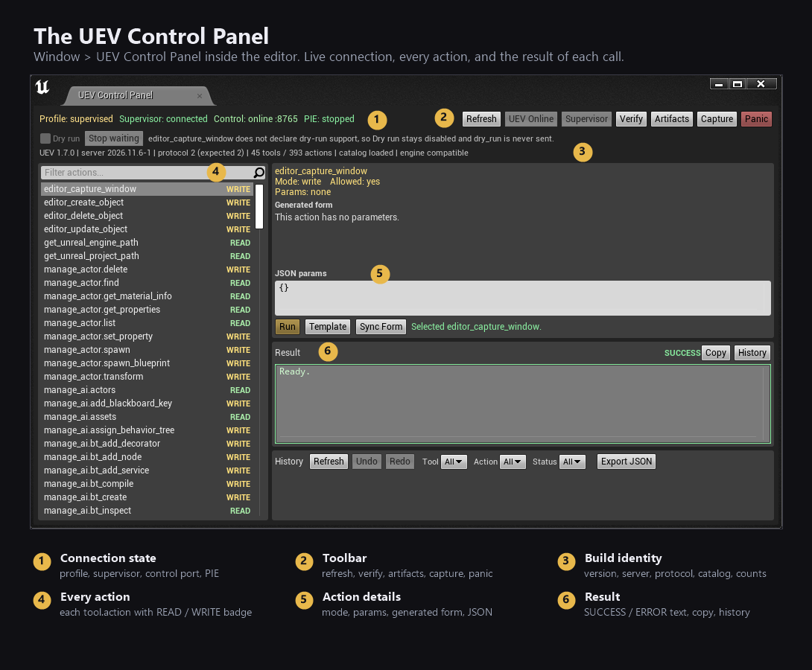

# First run: from zip to your first AI edit

This walkthrough assumes Windows 10 or 11, Unreal Engine 4.27, and one AI client that speaks MCP. Plan
for ten minutes, most of it the first plugin build.

By the end you'll have:

- the UEV runtime in `%LOCALAPPDATA%\UEV`,
- `UEVNative` and `UEVControlPanel` compiled into your project,
- your AI client showing `mcp__uev__*` tools,
- and an editor that changes when you ask it to.

## 0. Check the boring things first

- Editor version is **4.27.x**. The [Vite fork](https://vitestudio-tech.github.io/UnrealEngineVite-Docs/default-topic.html)
  of 4.27.2 is what the tools are developed against. `UEV_STRICT_ENGINE=1` turns an unknown 4.27
  build into a hard failure, and non-4.27 engines are always rejected.
- The project is a **C++ project**: it has `Source/<Project>.Target.cs` and at least one
  `*.Build.cs`.
- Visual Studio with the Unreal workload is installed, and UnrealBuildTool runs from the engine you
  are about to point at.
- Unreal Editor is closed.
- The engine has `PythonScriptPlugin` and `EditorScriptingUtilities` available (the installer
  offers to enable the first one).

You don't need Node.js, .NET, admin rights, or a network connection.

## 1. Install

1. Download `uev-1.7.0.zip` from the releases page and unzip it somewhere, `D:\UEV` will do.
2. Double-click `install.bat` in that folder.
3. The menu finds your project and engine. Confirm them, or paste paths when it asks.
4. Keep the recommended components: server, `UEVNative`, `UEVControlPanel`, supervisor, Python
   support, remote execution, project build, client config recipe.
5. Let it build. The first build compiles two editor plugins against your engine, so a few minutes is
   normal.
6. Pick your AI harness when prompted. If yours isn't on the list, let it print the snippet and paste
   it yourself.

What lands where:

| Location | Content |
| --- | --- |
| `%LOCALAPPDATA%\UEV` | server, bundled Node, supervisor, verifier, control token |
| `<Project>\Plugins` | `UEVNative` and `UEVControlPanel` sources and icons |
| `<Project>\Saved\UEV` | launcher, `mcp-client.json` recipe, installer backups |

The package folder is the installer, not the install. Moving or deleting it later does not break
anything, but keep it around for updates.

## 2. Register the server with your AI app

The installer wrote `<Project>\Saved\UEV\mcp-client.json`. That file is a **recipe**, not
registration: the client has to load it.

- If the installer supports your client (`-ListClients` shows the table), it already merged the
  entry. Restart the client.
- If it printed a snippet, paste that into the client's MCP config and restart.
- Claude Code users can also run
  `claude mcp add uev -- "C:\Users\<you>\AppData\Local\UEV\node\node.exe" "C:\Users\<you>\AppData\Local\UEV\app\dist\bin.js"`.
- DeepSeek Harness takes MCP servers through its `dsh-mcp-manager` plugin, and the recipe is what
  that plugin needs.

Tool names show up as `mcp__uev__manage_actor`, `mcp__uev__manage_blueprint`, and so on. If you
only see other servers' tools, the client hasn't reloaded its MCP list. Restart it fully, not just the
chat.

## 3. Start the stack and meet the panel

Two ways to start, pick one:

- **Full stack, the one AI clients want:** double-click `Launch UEV.bat` in the package folder and
  give it the project folder, for example `"Launch UEV.bat" "C:\Projects\MyGame"`. It starts the
  supervisor, which owns the editor process and the control API.
- **Panel only, with the editor already open:** open **Window > UEV Control Panel** (console:
  `UEV.ControlPanel`), click **Start MCP**, and wait for **Control: online**.



Reading the panel:

1. **Connection state**: profile, supervisor, control port, PIE state.
2. **Toolbar**: Refresh, UEV Online, Supervisor, Verify, Artifacts, Capture, Panic.
3. **Build identity**: package and server version, protocol, tool and action counts.
4. **Action list**: every tool and action, each tagged READ or WRITE.
5. **Action details**: mode, parameters, generated form and the JSON params box.
6. **Result**: SUCCESS or ERROR for the last run, with copy and history.

Click **Verify** once. It checks the server files, the token, the plugins and the catalog, and tells
you what is missing instead of failing silently.

A red line about dry-run support for an action is normal. Some actions can't be dry-run, so the Run
button stays honest and the panel says so.

## 4. Your first prompts

Start small. These are ordered by how much they change.

1. **Look around.**
   *"List the actors in the current level and tell me which ones are lights."*
   Uses `manage_actor.find` or `manage_level.actors`.
2. **Read something real.**
   *"Show me the properties of the selected actor."*
   Uses `manage_actor.inspect` or `manage_object.properties`.
3. **Change one thing.**
   *"Move the selected actor up by 100 units and give it the label 'Test Cube'."*
   A WRITE action. The panel records it and the editor's undo history stays valid.
4. **Make something new.**
   *"Create a material instance from `M_Basic` called `MI_Test`, set its base color to orange, and
   apply it to the selected actor."*
5. **Look at the result.**
   *"Capture the editor viewport and show me."*
   Uses `editor_capture_window`, and the image lands in `%LOCALAPPDATA%\UEV\captures`.

If a call fails, the panel shows the error and the arguments that produced it. Ask the assistant to
read the log (`manage_debug.log_tail`), or press **Verify** again.

## 5. How a tool call is shaped

Namespace tools take one action and a params object:

```json
{ "action": "spawn", "params": { "class": "StaticMeshActor", "label": "Crate", "location": [0, 0, 100] } }
```

Useful extras on most calls:

- `dry_run: true` validates the call without touching the editor, where the action supports it.
- `save: false` batches graph edits. Then call the explicit `save` action once.
- `manage_batch` runs a list of calls in order, each still passing its own safety check.

## 6. Everyday habits

- **Watch the panel, not just the chat.** It's the ground truth for what ran.
- **Batch expensive things.** Graph edits auto-save by default, so `save: false` plus one final save
  is much faster for many-node work.
- **Dry-run the big writes** when the action supports it.
- **Keep the client session short-lived** while you experiment. A reconnect reloads the live catalog.
- **Panic is safe.** It stops the supervised stack without touching your project files.

## 7. When it does not work

| Symptom | First thing to check |
| --- | --- |
| Panel says **Control: offline** | Click **Start MCP**, and check that the editor's Python plugin is enabled |
| Client shows no `mcp__uev__` tools | Restart the client, and check the entry exists in its MCP config |
| `Verify` fails on the build | Engine path, Visual Studio workload, editor closed during build |
| Tool call times out | The editor is busy (shader compile, PIE). Try again or check the panel history |
| "Unknown action" | The catalog changed. Refresh the panel and reconnect the client |

More in [troubleshooting.md](troubleshooting.md).
