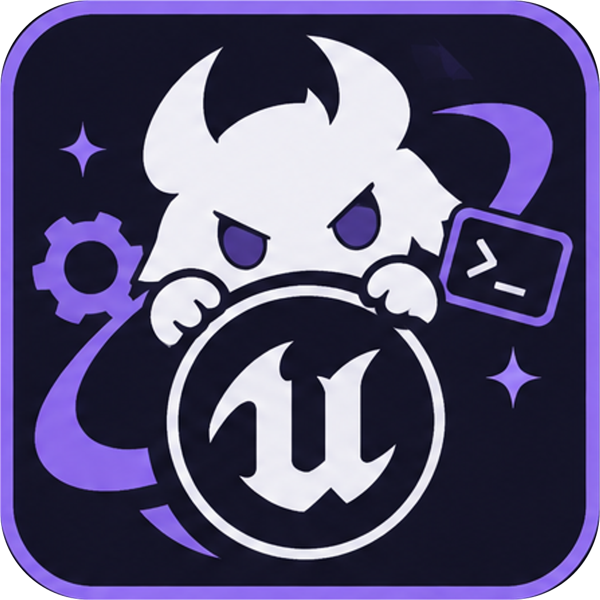
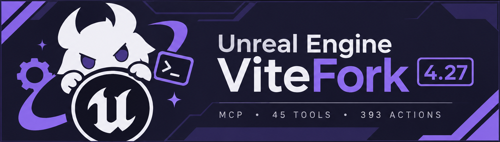
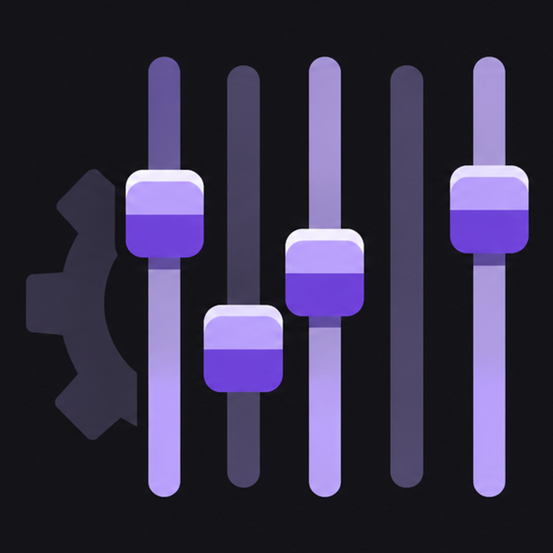

<p align="center">
  <br>
  
</p>

# UEV: UnrealEngineVite MCP for UE 4.27

**An AI copilot for Unreal Editor, installed as a local Windows package.**

UEV connects an AI assistant to your Unreal Engine 4.27 editor. Instead of clicking through menus, you describe what you want in plain English. The assistant can look around your project, create or change things, and show you the result in the editor.

It does not replace Unreal or make artistic decisions for you. It gives an AI assistant hands and eyes inside the editor, with a safety layer and an undo path.

MCP means **Model Context Protocol**, a standard way for AI apps to use tools. This package contains the Unreal side of that connection, the AI tool server, a supervisor that keeps things running, and a native control panel inside the editor.

> **Package version:** 1.7.0, **Server version:** 2026.11.6-1, **Protocol:** 2
>
> This is a built distribution, not the source repository. Publish it as a release artifact; keep the source in the repository.
>
> **1.7.0 is UEV-only.** The installer, supervisor, project paths, per-user state and environment variables say UEV; there is no compatibility layer for an earlier spelling. See [If you have an older UEV build installed](#if-you-have-an-older-uev-build-installed) and `docs\migration-1.7.md` for what was removed.

## The short version

1. Double-click **`install.bat`** and choose your `.uproject`.
2. If you use **Command Code**, run the installer with `-RegisterCommandCode` (or use the menu option). If you use another AI app, merge `Saved\UEV\mcp-client.json` into that app's own MCP list. Registration is the one step the package cannot do for another app.
3. Start everything with **`Launch UEV.bat`**. Double-click it and enter the project folder, or run:

   ```bat
   "Launch UEV.bat" "C:\Projects\MyGame"
   ```

4. In the editor, open **Window > UEV Control Panel**. If **Control** is offline, click **Start MCP**. Click **Verify** to check the install.

There is no separate `Start-Supervisor.bat` or `verify.bat` to run. The panel has **Verify**, and the launcher starts the whole stack.

## Where everything lives (plain English)

Look, there are two folders. Neither one is a mistake.

- **The package folder** is the installer. It is the box the thing came in. It has the payload, the installer, and the docs. It does not have to stay where it is.
- **`%LOCALAPPDATA%\UEV`** is the installed runtime. That is `C:\Users\<you>\AppData\Local\UEV`. It holds the MCP server, its own Node, the supervisor, the verifier, and the stack/install files. This is the copy that actually runs.
- **Your project folder** gets only the parts Unreal must load from the project: the native plugins, the `.uproject` entries, and `Saved\UEV` (launcher, client recipe, backups).

The installer **copies** files to those places. It does not move or delete the package. The MCP command points at the installed copy in AppData, not at the zip, so moving or deleting the package later does not break the MCP. Keep the package around if you want to update or reinstall.

Why AppData? Because it is per-user, writable without admin rights, and shared by every Unreal project. One server/Node/supervisor copy instead of 170 MB per project. Windows hides `AppData` in Explorer by default; paste `%LOCALAPPDATA%\UEV` into the address bar and you will see it.

If you are looking for the “real” install, it is AppData. If you are looking for the thing you downloaded, it is the package folder. Both are supposed to exist.

## If you have an older UEV build installed

1.7.0 installs clean: it does not read, migrate or delete state from an earlier UEV build, and it does not recognize an earlier spelling of a variable, path, launcher or pipe.

- **Version surfaces report 1.7.0.** `/api/health`, the control descriptor, the control panel, `manifest.json` and the installer all say product `1.7.0` on protocol `2`; the server version is unchanged.
- **Supervisor.** `UEVSupervisor.exe` is the only supervisor binary the package ships or registers, and it serves exactly one pipe, `\\.\pipe\uev-supervisor`.
- **Paths.** The runtime is `%LOCALAPPDATA%\UEV`, project state is `<Project>\Saved\UEV`, and per-user state is `%USERPROFILE%\.uev`. Nothing else is read or written.
- **Environment.** `UEV_*` is the only prefix read. A client config that still sets another prefix keeps starting, but those variables are ignored.
- **Client registration key is `uev`.** That key names every tool in your AI client (`mcp__uev__manage_code`); the installer writes it and nothing else.
- **Uninstall leaves no residue.** `-Uninstall` removes the install root, its control descriptor, `<Project>\Saved\UEV` and backups; add `-PurgeUserState` to also remove the shared `%LOCALAPPDATA%\UEV` runtime and the `~/.uev` journals. No shortcuts, services, firewall rules or registry run keys are ever created.

To move to 1.7.0 from an earlier build, uninstall the old one with its own `uninstall.bat` (editor closed) and install 1.7.0 fresh. 1.7.0 imports nothing from the old install, so save anything you want to keep from its state directories before you uninstall.

If the release you actually need is the compatibility build rather than this clean-break build, use the archived `1.7.0-c` package instead.

## Read this first: installing is not connecting

There are two separate steps:

1. **Install the package.** This puts the server, supervisor, and Unreal plugins on disk.
2. **Register the server with your AI app.** This tells your AI app that the server exists and is allowed to run.

Step 2 is not optional. The package cannot add itself to an AI app's MCP list. A file named `mcp-client.json` is a **recipe** for the connection; it is **not** registration. This is the most common failure:

- The Unreal control panel says **Control: online**.
- The server is running correctly.
- The AI app still shows no Unreal tools, because the server was never added to that app's MCP list.

If you use **Command Code**, the fastest path is:

```powershell
.\install.ps1 `
  -Project "C:\Projects\MyGame\MyGame.uproject" `
  -RegisterCommandCode `
  -Update -Yes
```

`-RegisterCommandCode` merges the server into `%USERPROFILE%\.commandcode\mcp.json` (existing servers are preserved; the file is backed up). Then **restart Command Code or open `/mcp`** so it reloads its MCP list. Verify:

```powershell
cmdc mcp list
```

You should see `uev` and `enabled`. Native tools are named like `mcp__uev__manage_code`.

If you use another AI app, merge the generated `Saved\UEV\mcp-client.json` into that app's MCP configuration using its own "add MCP server" or "import JSON" command. Do not assume that writing the file is enough.

## Why people use it

- **Less repetitive clicking.** Ask for something in a sentence instead of walking the same menu path for the tenth time.
- **It works with your real project.** The assistant can inspect the level, assets, classes, settings, and existing content before changing anything.
- **You can see the changes.** Actors, lights, materials, Blueprints, widgets, and level edits appear in the editor and viewport.
- **It is not a black box.** The native panel shows tool calls and pass/fail history, and the safety layer can restrict writes.
- **It is local.** The control API is loopback-only and protected by a per-session token. No cloud service is required.
- **It is reversible.** Configuration files are backed up, the installer keeps a manifest, and the editor's own undo/redo history is available.
- **It is built for your engine.** The two native plugins are compiled from source by the installer for your exact engine and project, so an engine update does not leave you with a mismatched prebuilt plugin.
- **No Node or .NET setup.** The package includes its own Node runtime and a self-contained supervisor.

## What it can do

The assistant has a large catalog of editor actions (45 tools, 38 namespaces, 393 actions in this build). In practical terms, it can help with:

- **Actors and levels:** place, move, duplicate, delete, and inspect actors; work with lights, volumes, navigation, splines, and level structure.
- **Materials and textures:** create and edit Material or MaterialFunction expression graphs, create MaterialInstance assets with `manage_material.create_material_instance`, assign materials, and set parameter values.
- **Blueprints and UI:** create or update Blueprints, widgets, and widget hierarchies; author event, function, variable, and Construction Script graphs with component references, branches, and macros.
- **Animation:** author AnimGraph nodes and state machines, and edit animation sequences and montages (notifies, curves, sync markers, slots, sections, and segments).
- **Content:** inspect and manage assets, folders, levels, and project settings.
- **Sequences and presentation:** work with level sequences, lighting, audio, and post-process-related setup where the engine APIs allow it.
- **Editor operations:** run Python checks, read logs, start/stop PIE, inject keyboard and PIE mouse input, move the camera, inspect the world outliner, and capture the editor.
- **History:** use the native UEVNative plugin for transaction-aware undo and redo.

Graph authoring is compiled into the `UEVNative` plugin and targets the UE 4.27.2 NvRTX/Vite fork; the installer still source-builds it against the target project's engine. MaterialFunction creation supports function, material-layer, and layer-blend asset types. Graph mutations auto-save by default; pass `save: false` to batch edits, then call the explicit `save` action.

### The two native plugins

| Plugin | Icon | What it does |
| --- | --- | --- |
| `UEVNative` |  | Transactions, history, reflection, and graph, animation and material authoring. Shows as **UEV Native** in the Unreal plugin list. |
| `UEVControlPanel` |  | The **Window > UEV Control Panel** tool window: connection status, recent calls, pass/fail results, generated parameter forms, Start/Stop MCP, Verify, Dock and Panic. |

Each plugin ships its icon as `Resources\Icon128.png` alongside the source, so an engine or marketplace view that reads plugin icons shows the right one.

### What it looks like in the editor

- **Viewport and editor changes** are visible as they happen.
- **Capture UI** saves a screenshot of the editor or a Slate/UMG window to `%LOCALAPPDATA%\UEV\captures` using native Windows capture, with best-effort macOS/Linux capture paths.
- **UEV Control Panel** is a single native tool window with a fixed minimum size, one Window-menu entry, connection status, recent calls, pass/fail results, schema hints, generated forms for scalar, enum, object, and array parameters, and a Template action.

  
- **Start MCP / Stop MCP** is built into the panel. If the control is offline while the editor is open, click Start MCP; the bundled Node runtime starts the local control API and the panel changes to Stop MCP.
- **Tool history** records up to 200 entries, filters out editor polling noise, and marks failed checks in red.
- **Artifacts** from a tool call can be opened from the panel.
- **Dock and Panic** controls let you keep the panel out of the way or stop the supervised stack.

## What you need on your side

This package is self-contained for Node and .NET. The Unreal side is still yours to provide:

- Windows 10 or newer.
- Unreal Engine **4.27.x**. Graph authoring targets the **UE 4.27.2 Vite fork**, whose manual
  (build steps, console variables, UE5 migration) is at
  [vitestudio-tech.github.io/UnrealEngineVite-Docs](https://vitestudio-tech.github.io/UnrealEngineVite-Docs/default-topic.html).
  A stock 4.27 works for the engine-agnostic tools.
- A **C++ project** (it needs `Source/<Project>.Target.cs` and `*.Build.cs`).
- Visual Studio and UnrealBuildTool, so the installer can compile the two source editor plugins.
- The engine's **PythonScriptPlugin** (the installer can enable it; it is an Unreal plugin, not a system Python install).
- **EditorScriptingUtilities** somewhere in the engine or a configured stripped-plugin backup.
- Live Coding is optional. If available, the installer can enable it. New UCLASSes, headers, and class-layout changes still require a full build.
- Close Unreal Editor before installing, updating, or uninstalling.

You do **not** need to install Node.js or the .NET runtime. You do **not** need administrator rights, a Windows service, or internet access during installation.

## Install

1. Copy or unzip this package anywhere on the Windows machine.
2. Close Unreal Editor.
3. Open the package folder in Explorer and double-click **`install.bat`**.
4. Follow the PowerShell menu. It detects the project, engine, Python plugin, Live Coding, and optional editor plugins.
5. Let it build when prompted.
6. **Register the server with your AI app** (see “Read this first” above).
7. Start the stack and confirm the AI app shows the Unreal tools.

From a terminal, the same thing:

```bat
cd /d "<folder where you unzipped this package>"
install.bat
```

The installer asks for the project and engine if it cannot find them, then shows a component menu. Recommended defaults install the server, `UEVNative`, `UEVControlPanel`, the supervisor/control API, Python support, loopback remote execution, a project build, and an MCP client config **recipe**. The recipe is not registration; use `-RegisterCommandCode` or `-ClientConfig` to add it to a client.

### One-command install

Replace the example paths with yours:

```powershell
.\install.ps1 `
  -Project "C:\Projects\MyGame\MyGame.uproject" `
  -Engine "C:\Program Files\Epic Games\UE_4.27" `
  -Components Server,History,Panel,Supervisor,Python,EditorScriptingUtilities,RemoteExecution,Build,ClientConfig `
  -Profile supervised `
  -Yes
```

If your engine is registered with the project, you can omit `-Engine`. Use `-Profile unattended` for a read-only setup, or `-Profile supervised` to allow writes under the safety gateway.

If `PythonScriptPlugin` is disabled, the installer explains what is missing and offers to enable it. If it is missing from the engine, no external Python install will fix it: restore the engine plugin or point `-Engine` at the correct engine. To install without Python deliberately, add `-NoPython -ContinueWithoutPython`; the MCP server will not be able to call the editor until Python is enabled.

If Live Coding is disabled, the installer warns and can write the project's Live Coding setting. That does not let Live Coding add new reflected classes; use a full build for those.

### What the installer changes

- Copies the server, bundled Node, and supervisor under `%LOCALAPPDATA%\UEV`.
- Copies source-only `UEVNative` (including `UEVGraphAuthoring`) and `UEVControlPanel` into `<Project>\Plugins`.
- Adds the needed plugin entries to the `.uproject`.
- Writes loopback Python remote-execution settings to `DefaultEngine.ini`.
- Optionally writes the Live Coding setting.
- Builds the project editor target so the native plugins are loadable.
- Creates a per-project launcher and MCP client config recipe under `<Project>\Saved\UEV`.
- With `-RegisterCommandCode`, merges that entry into `%USERPROFILE%\.commandcode\mcp.json` and backs it up.
- Backs up configuration under `<Project>\Saved\UEV\backups`.

## Launch it

Installing does **not** start the MCP. You can start it from inside the editor, or from the package. Choose one path depending on what you are doing.

### Option A: start from the UEV Control Panel (editor already open)

Use this when Unreal Editor is already open and you want to use the panel. The separate **Supervisor** button arms a handoff that starts the supervisor after you save and close this editor. The handoff runs as a one-shot Windows scheduled task, so it survives editor shutdown; progress and failures are written to `Saved\UEV\supervisor-handoff.log`.

1. Open the **UEV Control Panel** from the editor's **Window** menu, or run this in the editor console:

   ```text
   UEV.ControlPanel
   ```

   `UEV.DockControlPanel` is an alias for the same single panel.

2. Click **Start MCP** in the panel toolbar.
3. Wait for **Control: online**. The button changes to **Stop MCP**, the tool catalog loads, and the supervisor shows **standalone**. That is normal for this path.
4. Click **Stop MCP** when finished. Closing the editor also stops the control process.

This starts the local MCP control API with the bundled Node runtime. It does **not** launch another editor, and it does **not** need the cold-start launcher. It uses the supervised profile.

The panel's Start button is for the panel itself. Your AI client still has its own MCP connection (see below); starting the panel does not configure the AI client.

### Option B: start the full stack from the package

Use this when you want the package to launch Unreal Editor, or when you want the supervised stack for an AI client.

From the package folder:

```bat
"Launch UEV.bat" "C:\Projects\MyGame"
```

Or run the launcher the installer created:

```powershell
& "C:\Projects\MyGame\Saved\UEV\run-stack.ps1"
```

This opens Unreal Editor, starts the supervisor and local control API, and loads the UEV Control Panel. Wait until the editor is open and the panel says the control is online. Close Unreal Editor first if it is already running. The panel's **Supervisor** button can also arm the handoff: save your work, close the editor, and the supervisor starts the supervised stack automatically. The handoff task and its log are under `Saved\UEV`.

The package's **`Launch UEV.bat`** takes the **project folder**, not the `.uproject` file. If you double-click it, it prompts for the folder. The generated `run-stack.ps1` is the per-project launcher and is the simplest option once the installer has finished.

**Why is there still one launcher outside the editor?** The UEV Control Panel lives inside Unreal Editor, so it cannot start the editor or the supervisor that must own it. `Launch UEV.bat` is the single small entry point that starts the supervisor, the editor, and the control API. The panel can start the control API once the editor is already open, but it cannot cold-start the stack.

### Connect your AI client

Register the client once using `Saved\UEV\mcp-client.json` (details in the next section). After that, start the AI client or tell it to reconnect to the MCP server. The client launches its own MCP server process automatically; you do **not** run a separate MCP command or keep another window open.

The editor must already be open. For the AI-client workflow, Option B is the recommended path because it also starts the supervisor/watchdog. If you use Option A, the panel's control API is online but the client still has its own server connection; the supervisor-specific watchdog is not running.

## Register your AI assistant (one-time, required)

**Generating this file does not register the server.** It is a recipe you must add to your AI app.

The installer writes a ready-to-copy server entry here:

```text
<Project>\Saved\UEV\mcp-client.json
```

It looks like this (the installer fills in your real paths):

```json
{
  "mcpServers": {
    "uev": {
      "transport": "stdio",
      "command": "C:\\Users\\<you>\\AppData\\Local\\UEV\\node\\node.exe",
      "args": [
        "C:\\Users\\<you>\\AppData\\Local\\UEV\\app\\dist\\bin.js"
      ],
      "env": {
        "UEV_PROFILE": "supervised",
        "UEV_BIND_ADDRESS": "127.0.0.1",
        "UEV_COMMAND_ADDRESS": "127.0.0.1",
        "UEV_MULTICAST_TTL": "0",
        "UEV_SUPERVISOR_PIPE": "\\\\.\\pipe\\uev-supervisor"
      }
    }
  }
}
```

Merge that entry into the MCP configuration of your AI client (Claude Code, Codex, Cursor, VS Code, Cline, or another MCP-capable client). The `install.ps1 -ClientConfig <path>` option can merge it into an existing JSON file with a backup, if that is easier.

### Command Code

Use the one-flag installer path:

```powershell
.\install.ps1 -Project "C:\Projects\MyGame\MyGame.uproject" -RegisterCommandCode -Update -Yes
```

This merges the entry into `%USERPROFILE%\.commandcode\mcp.json` without deleting other servers. Then restart Command Code or open `/mcp`; a running session will not see the new tools until it reloads its MCP list. Check with:

```powershell
cmdc mcp list
```

The server should appear as `uev`, `stdio`, `enabled`. In a session, the tools are named like `mcp__uev__manage_code`. If you only see `mem0` or no Unreal tools, registration or reload is still pending.

### Other clients

The installer knows where 20 clients keep their MCP list. Double-click `install.bat` with no arguments and it asks which harness should receive the entry, or drive it from the command line:

```powershell
.\install.ps1 -ListClients
.\install.ps1 -Project "C:\Projects\MyGame\MyGame.uproject" -Client claude-code -Update -Yes
.\install.ps1 -Project "C:\Projects\MyGame\MyGame.uproject" -Client vscode -ClientScope project -Update -Yes
```

Writable JSON configs (other servers preserved, the previous file backed up as `*.uev-backup-*`, malformed JSON refused): Claude Code, Claude Desktop, Cursor, VS Code, Windsurf, Roo Code, Gemini CLI, Zed, Kiro, Pi and Google Antigravity. Clients whose config is TOML, YAML, or managed inside the app print the exact snippet instead: Codex CLI, Continue, goose, opencode, Cline, JetBrains, GitHub Copilot CLI and DeepSeek Harness (which takes MCP servers through its dsh-mcp-manager plugin). The custom target prints the universal recipe for any other stdio client.

For an arbitrary config path, `-ClientConfig <path>` still merges the entry into an existing JSON file.

Do not paste the file path into the AI chat and assume that is registration. The app must actually load that server entry.

## Tool-call parameter shape

All namespace tools use the same envelope:

```json
{
  "action": "read_source",
  "params": {
    "path": "Source/MyGame/MyGameCharacter.cpp"
  }
}
```

`params` is a **JSON object**, not a JSON-encoded string. Nested values are real objects and arrays:

```json
{
  "action": "spawn",
  "params": {
    "class_name": "PointLight",
    "location": { "x": 0, "y": 0, "z": 200 }
  }
}
```

Wrong:

```json
{
  "action": "read_source",
  "params": "{\"path\": \"Source/MyGame/MyGameCharacter.cpp\"}"
}
```

The outer request is valid JSON, so it can look correct, but `params` arrives as a string. The server then validates it against that action's strict schema and rejects it with an error such as `expected object, received string`. Some clients parse nested values automatically; some harnesses pass them through unchanged. Send a real object. If an action needs no parameters, send `{}` or omit `params`. The server accepts a JSON string as a compatibility fallback, but object form is the supported form and is what the documentation and examples use.

The namespaced tool list may display `params` as `any` or as a union because each action has a different schema. That does **not** mean arbitrary shapes are accepted; the selected action validates its own fields strictly.

## Everyday examples

You do not need to memorize tool names. Ask naturally:

- "Look at the current level and tell me what is in it."
- "Place three point lights around the fountain and make them warm white."
- "Create a simple red material and apply it to the selected cube."
- "Build a small UI widget with a title and a Play button."
- "Show me the world outliner and check whether anything is missing."
- "Take a screenshot of the editor so I can see the result."
- "Undo the last change and tell me what changed."

The assistant can inspect before acting, and the panel records what was attempted. Failed checked operations are shown in red.

## Safety and control

- The control API listens only on `127.0.0.1` and requires a bearer token.
- Requests with an `Origin` header are rejected.
- `unattended` is read-only; `supervised` allows writes through the safety gateway.
- Python remote execution is configured for loopback with multicast TTL 0.
- The supervisor owns Unreal Editor through a Windows Job Object, so `panic` can shut down the whole stack.
- Crash guards refuse destructive operations before the engine is touched, including deleting protected content and mutating the editor world while Play In Editor runs. They return `error.code: "unsafe_operation_refused"` and the guard's name. `UEV_ALLOW_UNSAFE_OPERATIONS=1` disables them for a deliberate, backed-up session.
- The supervisor watchdog restarts the editor and control plane after an unexpected exit (default 3 restarts per 10 minutes), logs the newest `Saved/Crashes` report with its assertion, and honours `--no-restart`.
- The installer backs up configuration and writes only managed files. Uninstall refuses to delete modified plugin source without `-Force`.
- No admin rights, Windows service, or cloud relay are used.

## Update, verify, uninstall

Update by running the installer again:

```powershell
.\install.bat -Project "C:\Projects\MyGame\MyGame.uproject" -Engine "C:\UE_4.27" -Update -Yes
```

Check an installation:

1. Open **Window > UEV Control Panel** and click **Verify**. The panel runs the installed verifier and shows the pass/fail report in the result area.
2. Or run the installed verifier directly:

```powershell
& "$env:LOCALAPPDATA\UEV\installer\install.ps1" -Verify -Project "C:\Projects\MyGame\MyGame.uproject"
```

**What Verify checks:** the server entry, the bundled Node runtime, the editor Python scripts, the plugin manifest, the product version, the UEV supervisor binary, the project data directory, the native plugin DLLs, the project plugin entries, and Python remote execution. It does not launch the editor or change your project.

Remove the managed install:

```bat
uninstall.bat -Project "C:\Projects\MyGame\MyGame.uproject"
```

Uninstall removes the managed plugin directories, plugin entries, generated config, launcher, manifest, backups and the project data directory (`Saved\UEV`). When that was the last project using it, the install root goes as well. The shared `%LOCALAPPDATA%\UEV` runtime and the per-user `~/.uev` journals are shared by every install, so they are kept unless you pass `-PurgeUserState`:

```bat
uninstall.bat -Project "C:\Projects\MyGame\MyGame.uproject" -PurgeUserState
```

Your project content is never touched, and the installer creates no shortcuts, services, firewall rules or registry run keys.

## Folder map

```text
uev-mcp-package\
  install.bat, install.ps1      # setup and update
  uninstall.bat                 # managed removal
  Launch UEV.bat                # start the editor + MCP stack
  supervisor\                   # self-contained supervisor (.NET)
    UEVSupervisor.exe
  payload\
    app\                        # MCP server and production node_modules
    node\                       # bundled Node runtime + license
    plugins\                    # source-only native plugins
    templates\                  # client config sample
  installer\                    # PowerShell installer module
  docs\                         # install, compatibility, security, troubleshooting
    assets\                     # banner, product icon and plugin art used by the docs
  FINDINGS.md                   # battle-test performance and correctness findings
  manifest.json                 # package metadata and requirements
  checksums.txt                 # integrity hashes
```

## Release notes

### 1.7.0

- Docs now ship a banner, a product icon and the two plugin icons; each plugin's icon lives at `Resources\Icon128.png` inside the source-only plugin.
- Clean break: the hidden compatibility aliases `manage_level_structure`, `manage_environment`, `manage_animation_physics`, `manage_behavior_tree` and `manage_ai_debug` are removed. Their actions live on `manage_level`, `manage_geometry`, `manage_physics` and `manage_ai`.
- `UEV_*` is the only environment prefix read; no other spelling is recognized. The installer, supervisor, control panel and launchers write `UEV_*` only.
- `manage_editor.screenshot` is the single screenshot action; `manage_vite.screenshot` was removed (it was the HighResShot path that tripped the render-profiler assertion).
- `manage_ai` gains behavior tree graph authoring: `bt_create`, `bt_inspect`, `bt_add_node`, `bt_remove_node`, `bt_move_node`, `bt_set_node_property`, `bt_add_decorator`/`bt_remove_decorator`, `bt_add_service`/`bt_remove_service`, `bt_set_blackboard`, `bt_compile` and `bt_repair_graph`. Every mutation authors the runtime tree and its editor graph in one transaction and returns the node id map (`ei:<execution_index>`, `ei:<n>/d<k>`, `ei:<n>/s<k>`, `root`); the actions require the `UEVGraphAuthoring` module that ships inside `UEVNative`. Ids are a snapshot, not a handle: adding a decorator or service consumes an execution index and renumbers the nodes after it, so re-read the map from the response or from `bt_inspect` before addressing a node again. `bt_add_node` appends when `index` is omitted, and `save: false` reports `dirty: true` instead of writing. `bt_repair_graph` rebuilds the editor graph and re-homes every compiled node instance into the tree asset before dropping the old graph, so the saved asset reopens with its root intact; an asset whose root pin points at a missing composite instance is refused with `graph_root_invalid` instead of being recompiled.
- `manage_widget` is designer-grade now: `insert_widget`, `reparent_widget`, `reorder_child`, `rename_widget`, `duplicate_widget`, `serialize_tree`, `set_style`, `set_brush`, `validate_widget` and `designer_screenshot` edit the widget tree and its rendering the way the UMG designer does. `insert_widget` and `reparent_widget` use the native `InsertChildAt`/`ShiftChild` hierarchy paths, so slot, padding, anchoring and z-order survive; deleting a widget also purges its event bindings, generated variable nodes, animations and variable-name entry, and renaming retargets bindings, so the blueprint still compiles. `set_style`/`set_brush` change only the named fields instead of replacing whole style structs, `list_delegates` reads the reflected delegate list, `list_bound_events`/`unbind_event` complete the event coverage, and `designer_screenshot` renders the designer preview through `FWidgetRenderer` (it needs the widget editor tab open and captures preview state, not PIE).
- `manage_blueprint` gains the authoring depth behind the graph surface: `list_graphs`, `inspect_graph`, `inspect_function`, `inspect_blueprint_model`, `inspect_construction_script`, `list_macros` and `inspect_macro` describe every graph (event, function, macro, construction script); `create_function` takes typed pins and a duplicate policy, `set_function_signature`, `rename_function` and `delete_function` edit signatures (renames rewrite the call sites, deletes report orphaned references); `create_macro_library`, `create_macro`, `set_macro_signature`, `rename_macro` and `delete_macro` author macro libraries with tunnel pins; `add_local_variable`, `update_local_variable` and `remove_local_variable` manage function locals; `reset_construction_script` and `verify_blueprint` close the loop. Graph ids are `UEdGraph::GraphGuid` values and stay stable across editor restarts, and every mutating call opens one undo transaction (signature and macro edits compile synchronously and are refused during PIE).
- Contract, identity, matrix and e2e suites updated for the reduced surface (38 namespaces, 45 tools), plus a rewritten `docs\migration-1.7.md` (the 1.6.0 guide is retired).
- Identity finish: the installer, supervisor and runtime paths are UEV everywhere. The supervisor binary is `UEVSupervisor.exe` and it serves the `uev-supervisor` pipe only; project runtime state lives in `Saved\UEV` and per-user state in `~/.uev`.
- Packaging names are `uev-mcp-1.7.0-release` and `uev-1.7.0.zip`; the frozen 1.6.0 catalog fixture is kept as history and `tests\fixtures\catalog-1.7.0.json` is the contract-tested one.
- Installer fixes: `stack.json` is written even when client configuration is skipped (`-NoClientConfig`), so the shipped `run-stack.ps1` and `Launch UEV.bat` have a manifest to read; and install/update stop an already-running UEV stack before replacing the runtime instead of failing on the locked `node.exe`.
- `-Uninstall` now proves a clean removal: install root, control descriptor, project data directory (`Saved\UEV`) and backups are gone; no shortcuts, services, firewall rules or registry run keys are ever created. The shared `%LOCALAPPDATA%\UEV` runtime and `~/.uev` journals are kept unless `-PurgeUserState` is passed, so uninstalling one project never erases another install's state.
- Surface is now **45 tools / 38 namespaces / 393 actions**: the 1.5.0 count plus thirteen behavior tree actions, thirteen designer-grade UMG authoring actions, and nineteen Blueprint authoring-depth actions (functions, macros, Construction Script), minus the redundant `get_unreal_version` direct tool (`project_info.engine_version` reports the same string).

### 1.6.0

- Product renamed to **UEV** (UnrealEngineVite MCP). Server, control API, control panel, installer, supervisor and docs report the new identity; tool namespaces, actions and client registration keys are unchanged.
- Control API descriptor now carries `productName`, `productTitle` and `productSlug`; `/api/health` reports product `1.6.0` / server `2026.11.6-1` on protocol `2`.
- Crash guards: every known crash class now has a named guard that refuses the operation with a structured `unsafe_operation_refused` error before the engine is touched: protected-content deletes, Play In Editor editor-world mutations (spawn, delete, blueprint compile, asset delete/move), unplaceable blueprints, and viewport capture. The control panel refuses re-entrant refreshes instead of recursing.
- Auto-recovery: the supervisor watchdog restarts the editor and control plane after an unexpected exit with a bounded budget, records the newest `Saved/Crashes` report and its assertion, and reports `restarts` / `lastExitCode` / `lastCrashPath` in its status. `--no-restart` disables it.
- New regression suite `tests/crash-guards.mjs`: nine live checks including an induced crash that proves the watchdog restarts the stack (run it with `node tests/crash-guards.mjs`).
- Faster control plane: the catalog is built once per process and served compact, `/api/health` no longer waits on a supervisor pipe round trip, and startup phases are published in `/api/health.startup` plus one `UEV startup:` log line. Measured here: warm ping p50 16 ms / p95 21 ms, cold first ping ~0.4-0.9 s (was 1.6 s), catalog p50 15 ms. `node tests/control-latency.mjs --enforce` fails the build when a budget regresses.
- Stable object handles: every query result now carries `handle` = `uev:<kind>:<object path>` (deterministic, survives `release_handles`, PIE transitions and editor restarts) beside `native_handle` = the numeric `obj_<n>`. A handle that cannot resolve returns `handle_stale` instead of silently retargeting another object; the numeric `obj_N` handle keeps working for live objects.
- Fixed a real crash behind the old handles: the native retained-object registry rooted every object it retained, so deleting an actor that had ever appeared in a query result tripped `Assertion failed: !IsRooted()`. It now holds weak references that prune themselves, and `tests/stable-handles.mjs` proves the delete survives.
- Catalog schema fidelity: `/api/catalog` now describes nested and combined Zod shapes instead of stopping at the top level, so tuples publish their item type (vector/rotator/color shorthands), object nesting goes to depth 6, records publish `additionalProperties` only when the value type is typed, unions publish `variants` and merge the widest object branch, and discriminated unions merge all variant fields with the discriminator marked required. Measured on this build: 151 object parameters (119 typed), 59 typed arrays, 3 typed records, depth 4.
- The Control Panel consumes that metadata: nested object parameters render typed child rows (`background_color.r` as a number), array parameters render per-element rows (`conditions[0].case_sensitive` as a checkbox that edits element 0 in place), record parameters render key editors seeded from the value type (`Record values are number.`), and anything untyped falls back to the JSON box with an explicit hint. `tests/catalog-schema.mjs` asserts all of it live (15 checks) and `docs/TOOLS.md` is regenerated from the catalog with the nested rows included.
- API consistency: `manage_object.call` resolves inherited functions, `K2_` Blueprint aliases and case differences, and suggests near-miss names for typos; `widget_member_name`, `widget_component_name` and the `widget_name` alias are interchangeable on `bind_event`, `set_slot`, `set_widget_property` and the geometry actions (supplying two different names is an error, not a silent preference); and every graph action now answers `Graph not found: <name>` for a bad `graph_name` instead of falling back to a whole-blueprint node scan.
- Static switch writes: UE 4.27 exposes no writer for a `MaterialInstanceConstant` static switch, so 1.6.0 adds the `UEVMaterial` editor module (`SetMaterialInstanceStaticSwitch`, `GetMaterialInstanceStaticSwitch`, `ListMaterialInstanceStaticSwitches`). `manage_material.set_material_instance_parameter` with `parameter_type: static_switch` and `set_material_instance_parameters.static_switches` now write the switch; `inspect_material_instance` reports effective values in `static_switch_parameters` and override flags in `static_switch_overrides`. Without the module the action refuses with an explicit message instead of pretending success. New suite `tests/api-consistency.mjs` covers the four areas.
- Verification is a suite now, not a pile of probes: `tests/matrix.mjs` runs a declarative asserted case list (identity, catalog, query, editor, refusals, plus optional write round trips), `tests/contract-no-editor.mjs` validates the built server, identity, the `UEV_*`-only env contract, safety config and the recorded catalog fixture with no editor and no control API at all (the CI subset), and `tests/perf.mjs` gates warm ping p95 <= 60 ms, catalog <= 300 ms and compile <= 2 s against the 1.5.0 baseline recorded in `tests/perf-baseline.json`. Each suite writes a JSON artifact and exits non-zero on failure; `npm run test:matrix`, `npm run test:contract`, `npm run test:perf` (or `npm test` inside `tests/`) run them.
- Full green run on the live 1.6.0 stack: 26 matrix read checks, 7 matrix write checks, 24 contract checks, 4 performance checks. Measured here: warm ping p95 52.8 ms (0.82x the 1.5.0 p95), catalog max 20.1 ms, query p95 217 ms, compile p95 48.8 ms. `docs/testing.md` documents prerequisites, flags, thresholds and artifacts.
- Release and installer automation: `packaging/Release-UEV.ps1` type-checks and builds the server, regenerates `docs/TOOLS.md` from the live catalog, fails when the README/FINDINGS counts or the version banner drift from `/api/catalog`, builds the package, verifies every checksum, rejects `.git`/logs/run artifacts, then writes the zip and asserts its entry count against the tree. The installer now reads its version from the shipped `manifest.json` instead of a hardcoded constant, keeps stdout pure JSON for `-Json`, makes `-Update` real (preserves stack settings and custom client environment entries) and is covered by `tests/installer-dryrun.mjs` (exit 0, JSON parses, `ProductVersion` matches the manifest, nothing is written).
- Known limits still apply: viewport capture falls back to window capture when the render-target path is refused, MCP can only track assets opened through its own open actions, and dry-run previews are not implemented. Behavior tree graph authoring is no longer deferred (see above), but blackboard key renames are not exposed in 1.7.0 because the engine offers no editor notification for open behavior tree tabs.

### 1.5.0

- Added an explicit compatibility contract: package `1.5.0`, server `2026.11.5-1`, MCP control protocol `2`, and an engine range of `>=4.27.0 <4.28.0`. `manage_system.compatibility` reports the live engine, project file, loaded MCP plugins, and native/Python capability probes.
- The catalog is now generated live. `/api/catalog` and `/api/health` expose product, server, protocol, engine, and parameter schemas, including nested object properties and array item types for typed client forms.
- Consolidated duplicate namespaces. `manage_level` owns map lifecycle and outliner reads; `manage_geometry` owns all 13 shape and structure builders; `manage_ai` owns AI inspection plus Blackboard and Behavior Tree asset work; `manage_physics` owns physics setup, collision tuning, and PIE force/drop probes; `manage_editor_tool` owns Editor Utility Widget/Blueprint creation and launching.
- Removed the redundant `manage_inspection` namespace and the console/validation duplicates under `manage_system`. `manage_system` is now only `wait_for`.
- Added MaterialInstance introspection and editing: `manage_material.inspect_material_instance`, `set_material_instance_parameter` (scalar, vector, texture, static switch), `set_material_instance_parent`, plus batch `get_material_instance_parameters` / `set_material_instance_parameters` with per-parameter read-back verification.
- Added Core B authoring: `manage_ai` creates Blackboards and adds/removes/lists typed keys, inspects and assigns Behavior Trees; `manage_physics` sets collision profiles/responses on Blueprint defaults with native read-back, tunes CharacterMovement, and adds PIE force/impulse/torque plus `pie_drop_test` (native PIE spawning and component-level Z sampling).
- Added UMG tree editing (`set_anchors`, `set_alignment`, `set_offsets`, `set_size`, `set_padding`, `add_panel`, `set_slot`, `set_widget_property`, `list_events`) and editor utility creation (`create_actor_action_utility`, `create_asset_action_utility`, `create_editor_utility_blueprint`, `list_open_editor_tools`).
- Added editor-runtime control: enriched `project_info`, console log capture, window-based `screenshot`, `open_asset`/`close_asset`/`focus_asset`/`list_open_assets`, `reload_preludes`, and server-side `pie_expect` polling.
- Added control-server call identity and abandonment. `POST /api/call` returns `callId`; `GET /api/calls` lists active calls; `POST /api/cancel` stops waiting without claiming that editor-side execution was interrupted. A second mutating call returns `409 editor_busy` with the active call identity.
- Handler failures now return a structured HTTP 200 envelope (`ok:false`, `isError:true`, `callId`, `error`) instead of a bare HTTP 500.
- Surface is now **46 tools / 38 namespaces / 349 actions**. This is a deliberate reduction in duplicate surface, not a capability regression.
- Known limits in this build: viewport screenshots fall back to editor-window capture because in-process HighResShot crashes the 4.27 fork; `pie_drop_test` needs a clear drop site or `expected_ground_z` for its settle assertion; `list_open_assets` is MCP-tracked in 4.27 because `AssetEditorSubsystem.GetEditedAssets` is not exposed; utility Blueprints are created as plain `Blueprint` subclasses of the requested action-utility parent.
- Still deferred to 1.6: Behavior Tree graph authoring, Slate/OS-level UI automation, and dry-run previews for every mutating action.

### 1.1.7

- Added PIE-only mouse injection: `manage_editor.inject_mouse_button` (left/right/middle or a full `FKey` mouse name) and `manage_editor.inject_mouse_move` (relative mouse-look/input axes). It does not move the OS cursor or click editor UI.
- Surface is now **47 tools / 40 namespaces / 318 actions**.

### 1.1.6

- Replaced the redundant `Start-Supervisor.bat` and `run-stack.bat` with one cold-start entry point: **`Launch UEV.bat`**.
- Removed `verify.bat`; the UEV Control Panel now has a **Verify** button that runs the installed verifier and shows the full report. The installed verifier is also available at `%LOCALAPPDATA%\UEV\installer\install.ps1`.
- Added a plain-language **short version**, a **where everything lives** section, and explanations of why one outside-the-editor launcher is still needed and what **Verify** checks.
- Corrected the README action counts to **47 tools / 40 namespaces / 316 actions** and documented `manage_material.create_material_instance`.
- Corrected the stale **Good to know** caveats: keyboard injection and MaterialInstance creation now exist; mouse injection and new AnimSequence creation remain unsupported.

### 1.1.5

- Added one-call `manage_stack.relaunch`: discard/close the editor, run UBT, relaunch the packaged supervisor/editor, and wait for readiness. Call it from the stdio MCP server; a supervisor-hosted control API is terminated with the editor.
- Added native `UEVInputLibrary`: `start_pie_play` starts a real Play-in-Editor session with a local player, and `inject_key` sends a key press/release through `APlayerController::InputKey`. Exposed as `manage_editor.start_pie_play` and `manage_editor.inject_key`.
- Blueprint variables now support `is_instance_editable` and working `is_exposed` (ExposeOnSpawn), plus `manage_blueprint.set_variable_flags`.
- Added `manage_material.create_material_instance` with optional scalar/vector parameter overrides.
- `manage_editor.screenshot` accepts `destination_path` and copies a fast native editor-window capture there; viewport capture remains the default.

### 1.1.4

- Added on-demand stack lifecycle: `manage_stack.status`, `config`, `ensure`, and `stop`. The installer writes `%LOCALAPPDATA%\UEV\stack.json`, registers the packaged entry with `--stack-config`, and enables auto-launch from the first editor-dependent call.
- Added `manage_batch`: run up to 200 sequential MCP calls in one request. Each call keeps its normal safety guard; batches are not atomic, so finish write batches with explicit save actions.
- Added `run_python_async`, `get_async_result`, and `cancel_async` on `manage_editor`. Code can define `on_tick(delta, state)` and report progress through `Saved\UEV\async\<id>.json` without blocking the call.
- Added `manage_system.wait_for` for server-side predicate polling (PIE state, charge counts, actor properties, log/result markers).
- PIE start/stop retries a missing command channel before failing, which removes the common transition race.
- `manage_tools.describe_namespace` now returns the full action parameter schemas.
- Added `manage_blueprint.inspect_components`, map duplication via `new_level_from_template`, wider filtered log reads, and AnimGraph `add_graph_node` support for `function_name`, `target`, `variable_name`, and `node_kind`.
- JSON-string `params` are accepted at the transport layer and validated after decoding, with clear errors for invalid or non-object JSON.

### 1.1.3

- Added the missing **client registration** step: `-RegisterCommandCode` merges the server into Command Code's user MCP config, and the README now explains why `mcp-client.json` alone does nothing.
- The generated client config now includes `"transport": "stdio"`, so it can be merged directly into Command Code or another compatible client.
- Namespaced MCP tools now accept a JSON-string `params` value as a compatibility fallback, while continuing to validate the decoded object against the action schema. The documented form is still a real object.
- Corrected the README claim about MaterialInstance assets. At 1.1.3 the server could author material graphs and drive MIDs but did not create MaterialInstance assets; 1.1.5 added `manage_material.create_material_instance`.

### 1.1.2

- Fixed the Supervisor handoff. The button now registers a one-shot Windows scheduled task, uses absolute paths, survives editor shutdown, writes a handoff log, and deletes its generated `.ps1` and task XML after launch.

## Good to know

- **UE 4.27 only.** UE5 is not claimed or tested for this action catalog and native panel.
- **Installing is not registering.** See “Read this first.” The most common “it does nothing” report is a missing AI-client server entry, not a broken editor stack.
- **The source plugins must be built.** That is why Visual Studio/UBT and a C++ project are required. Do not copy prebuilt plugin DLLs from another machine; the installer builds them against the local engine.
- **Live Coding is limited.** It cannot add new UCLASSes, headers, or class layouts. Use a full build for those.
- **Not every Unreal feature is automated.** Keyboard injection is available through `manage_editor.inject_key`; PIE mouse buttons and mouse-look are available through `manage_editor.inject_mouse_button` and `manage_editor.inject_mouse_move`. Editor UI/Slate clicking and OS cursor movement are not supported. Creating new AnimSequence assets is not automated; MaterialInstance creation is available through `manage_material.create_material_instance`. Some editor dialogs require manual confirmation.
- **Registration is not universal.** `-RegisterCommandCode` handles Command Code; other clients must merge `Saved\UEV\mcp-client.json` into their own MCP configuration.
- **The AI still needs judgment.** Inspect important changes, use source control, and keep backups.

## More documentation

- `docs/install.md`: component contract, flags, and install details.
- `docs/compatibility.md`: supported engine/platform and prerequisites.
- `docs/security.md`: local API, profiles, and permissions.
- `docs/troubleshooting.md`: Python, Live Coding, build, and connection problems.
- `docs/testing.md`: the matrix, no-editor contract and performance suites, with prerequisites, commands and thresholds.
- `docs/migration-1.7.md`: the 1.7.0 clean break, what was removed, what does not carry over, and the new authoring surfaces.
- `FINDINGS.md`: what was battle-tested, measured latency, and known limits in this release.

## License

MIT for this integration. The bundled server preserves its upstream MIT license and attribution. Node.js is included under its MIT license. Epic Games engine plugins are not redistributed; the installer uses the plugins from your Unreal Engine installation.
